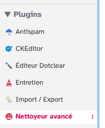
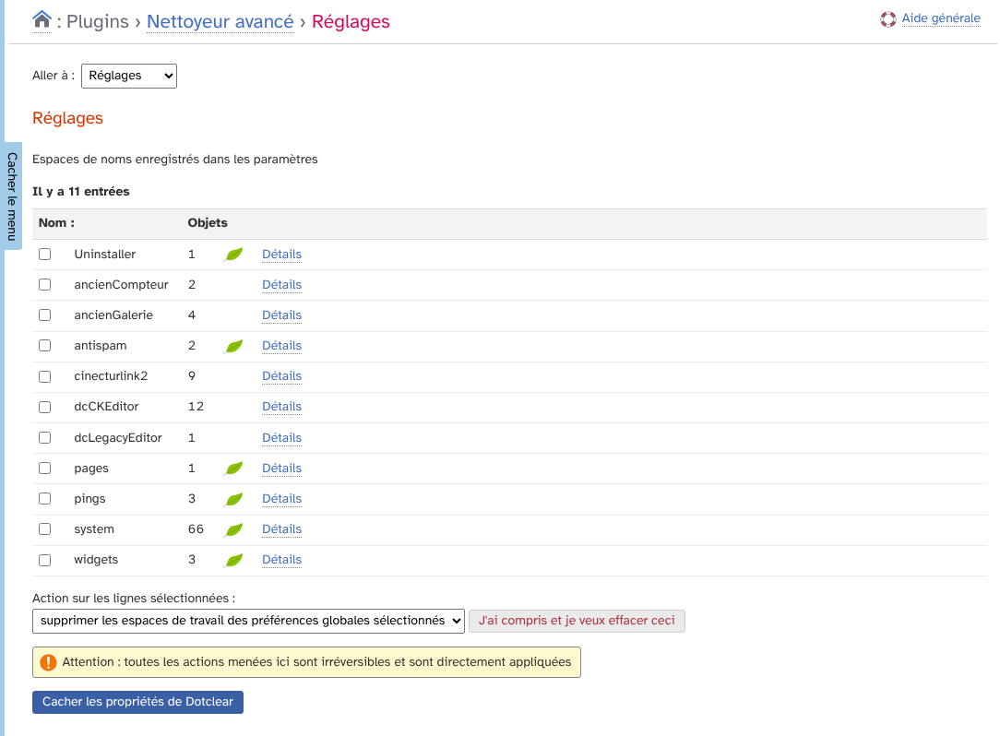
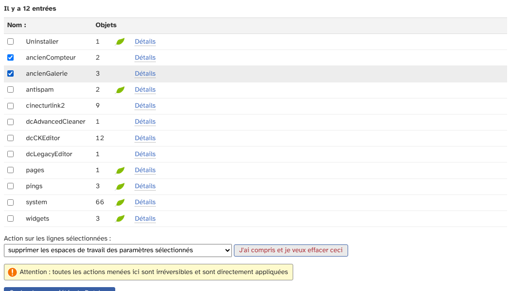
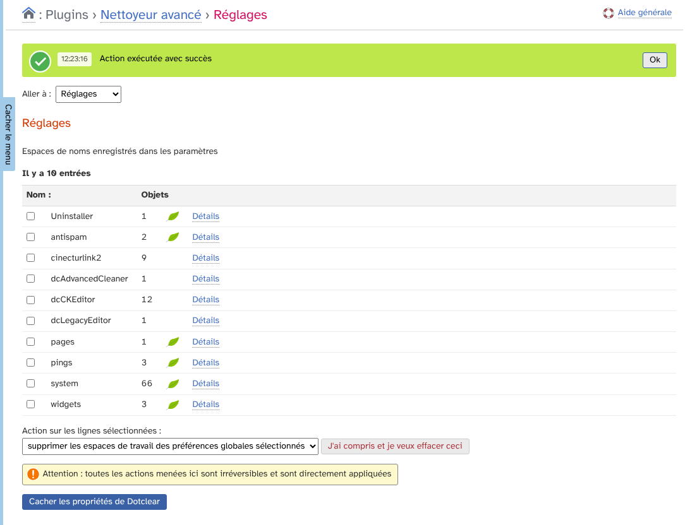
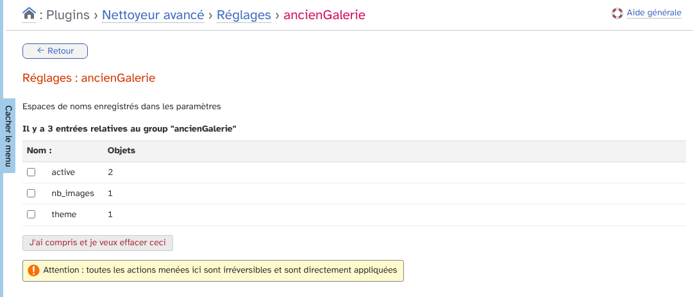
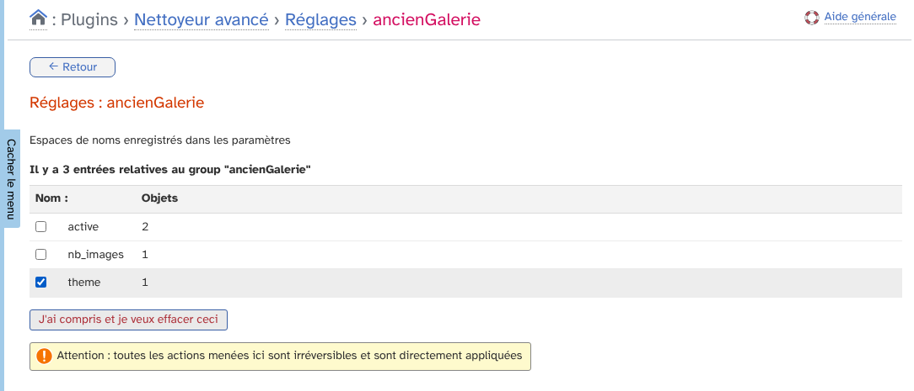
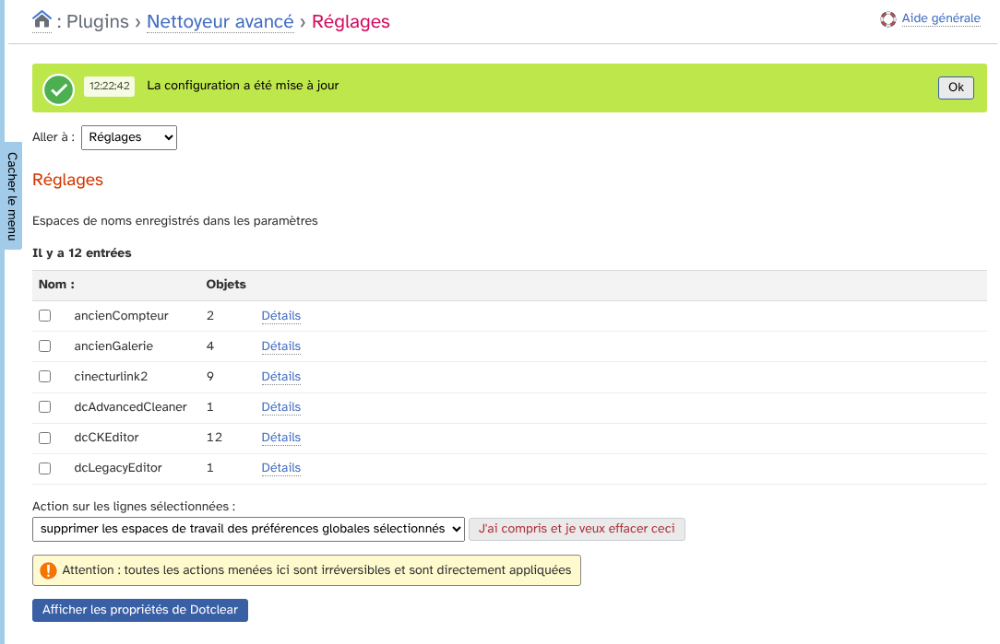

# Nettoyeur avancé (dcAdvancedCleaner) : guide d'utilisation

Ce guide explique comment utiliser l'extension dcAdvancedCleaner pour faire le ménage dans une installation Dotclear : restes d'extensions supprimées dans les réglages, les préférences, les tables, les versions, les journaux, le cache, le dossier var, les thèmes et les extensions.

L'extension est réservée aux super administrateurs. Elle a besoin de l'extension Uninstaller, fournie avec Dotclear.

**Attention : toutes les actions de cette page sont irréversibles et s'appliquent immédiatement. Faites une sauvegarde de la base de données et des fichiers avant de nettoyer.**

## Sommaire

1. [Ouvrir le nettoyeur](#ouvrir-le-nettoyeur)
2. [Choisir un nettoyeur](#choisir-un-nettoyeur)
3. [Lire la liste](#lire-la-liste)
4. [Effacer des éléments](#effacer-des-éléments)
5. [Voir le détail d'un groupe](#voir-le-détail-dun-groupe)
6. [Les neuf nettoyeurs](#les-neuf-nettoyeurs)
7. [Cacher les éléments de Dotclear](#cacher-les-éléments-de-dotclear)
8. [Tableau de bord](#tableau-de-bord)

## Ouvrir le nettoyeur

Dans le menu **Plugins**, cliquez sur **Nettoyeur avancé**.

## Choisir un nettoyeur

Le menu **Aller à** en haut de la page change de nettoyeur. La page se recharge dès que vous choisissez une entrée.

## Lire la liste

Chaque nettoyeur affiche un titre, une courte description et un tableau.

* **Nom** : l'élément trouvé, par exemple un espace de noms de réglages ou un dossier du cache.
* **Objets** : le nombre d'objets qu'il contient (réglages, lignes, fichiers…) ou, pour les versions, le numéro de version.
* **Feuille verte** : l'élément fait partie de la distribution officielle de Dotclear. Soyez très prudent avec ces éléments : les supprimer peut casser votre blog.
* **Détails** : ce lien, présent pour les réglages et les préférences, ouvre le détail du groupe.

La légende du tableau indique le nombre d'entrées trouvées.

## Effacer des éléments

Pour nettoyer :

1. Cochez les lignes à traiter.
2. Choisissez l'action dans la liste **Action sur les lignes sélectionnées**.
3. Cliquez sur **J'ai compris et je veux effacer ceci**.
4. Confirmez dans la fenêtre qui s'ouvre.

Le bouton reste grisé tant qu'aucune ligne n'est cochée. Une notification confirme l'action.

Les actions proposées dépendent du nettoyeur (voir plus bas).

## Voir le détail d'un groupe

Pour les réglages et les préférences, le lien **Détails** ouvre un espace de noms et liste ses entrées une à une, avec leur nombre d'occurrences (par exemple le réglage `active` existe une fois en global et une fois pour un blog).

Cochez les entrées à supprimer puis cliquez sur **J'ai compris et je veux effacer ceci**. Seules les entrées cochées sont supprimées, le reste de l'espace de noms est conservé. Le lien **Retour** ramène à la liste.

## Les neuf nettoyeurs

* **Réglages** : les espaces de noms des réglages. On peut supprimer l'espace global, celui des blogs, ou les deux.
* **Préférences** : les espaces de travail des préférences. On peut supprimer l'espace global ou les préférences des utilisateurs.
* **Tables** : les tables de la base de données. On peut les supprimer ou seulement les vider.
* **Versions** : les numéros de version enregistrés pour les extensions. Supprimer une version fait croire à Dotclear que l'extension n'a jamais été installée.
* **Journaux** : les tables de journaux de Dotclear.
* **Cache** : les dossiers du cache. On peut les supprimer ou seulement les vider.
* **Var** : les dossiers du répertoire var de Dotclear.
* **Thèmes** : les dossiers des thèmes du blog. Les fichiers du thème sont effacés.
* **Plugins** : les dossiers des extensions. Les fichiers de l'extension sont effacés.

Un bon usage consiste à repérer les restes d'une extension supprimée, par exemple `ancienGalerie`, dans les réglages, les préférences, les versions, les tables, le cache et var, puis à les effacer groupe par groupe.

## Cacher les éléments de Dotclear

Le bouton en bas de la page **Cacher les propriétés de Dotclear** retire des listes les éléments de la distribution officielle, pour ne voir que les vôtres. Le bouton devient alors **Afficher les propriétés de Dotclear**.

Ce choix est un réglage global : il s'applique à tous les utilisateurs de l'extension.

## Tableau de bord

Dans **Préférences**, onglet **Mon tableau de bord**, cochez **Nettoyeur avancé** puis cliquez sur **Ajouter à mes favoris** pour afficher une icône de raccourci sur la page d'accueil.

